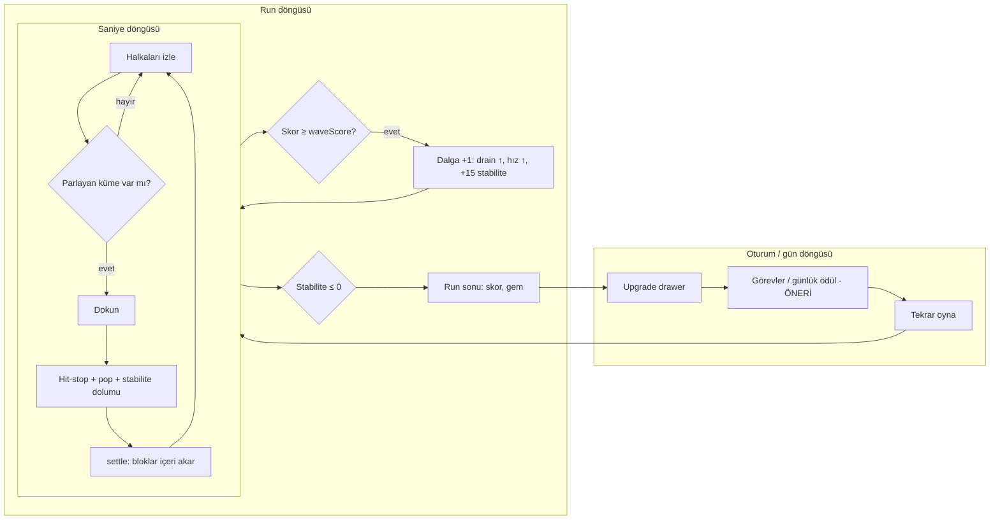
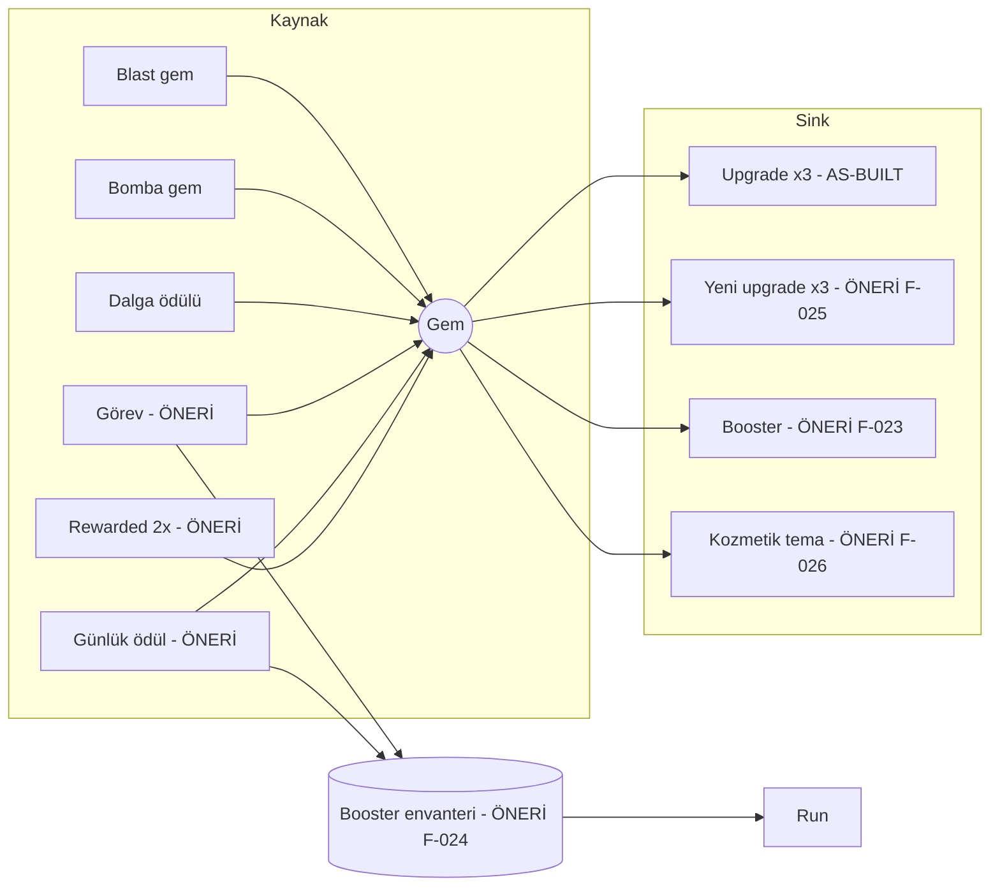
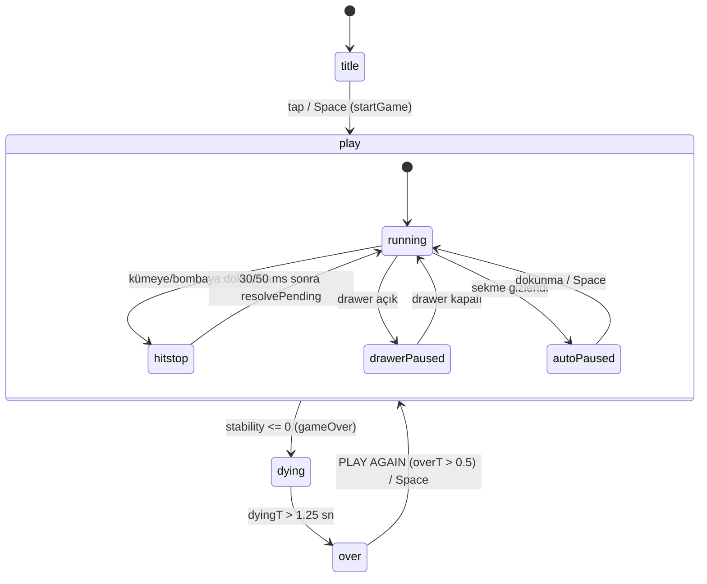
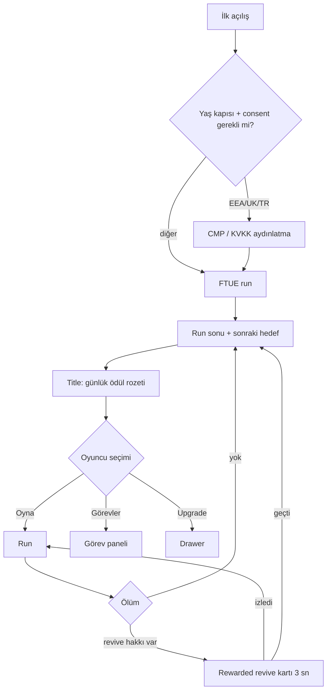

# 01 — Vortex Blast GDD (Game Design Document)

> Sürüm 1.0 · 2026-10-26 · Kapsam: as-built denetimi + önerilen tasarım
> Etiketler: `[AS-BUILT]` koddan doğrulandı (fonksiyon/sabit adıyla) · `[ÖNERİ]` yeni tasarım · `[ARAŞTIRMA S#]` → `00_RESEARCH.md` · `[VARSAYIM]` doğrulanamadı.
> **Not (2026-10-26, sonra):** Bu dokümandaki önerilerin tamamı uygulandı. Uygulanan nihai değerler ve doğrulama sonuçları **§14**'te. §1–13'teki `[AS-BUILT]` etiketleri, uygulama öncesi oyunu tarif eder.
> **As-built referansı:** `index.html` = commit `89f79ff` + çalışma ağacındaki commit edilmemiş performans değişiklikleri (sprite cache `buildBlockSprites`, `buzz` haptik, `queueResize`). 1442 satır, SHA-256 öneki `0BDBD034B1FBDB3A`.
> Sayısal tablolar `docs/tools/` scriptlerinin çıktısıdır (Ek C). Elle yazılmamıştır.

---

## 1. Yönetici özeti

**Tek cümlelik pitch:** Enerji Çekirdeği'nin etrafında farklı hız ve yönlerde dönen dört halka var. Halkalar hizalandığı an aynı renkli jöle blokları zincirleyip tek dokunuşla patlat, çekirdek sönmeden dalga atla.

**Vizyon:** 60–180 saniyelik run'lar, her dokunuşta tatmin edici "pop" ve uzun vadeli hafif meta. Hybrid-casual model: rewarded ağırlıklı reklam ve opsiyonel IAP.

**Design pillars:**
1. **Tek dokunuş, büyük patlama.** Her eylem tek tap. Etkisi hit-stop, parçacık ve sesle büyütülür. `[AS-BUILT hitStop=0.030, burst, Snd.blast]`
2. **Zamanlamayla eşleşme.** Halkalar dönüyor. Doğru anı beklemek bir beceri. `[AS-BUILT computeClusters, tolerance()]`
3. **Okunabilir kaos.** Hazır kümeler parlar, diğerleri geri çekilir. Yeni sistemler bu okunabilirliği bozmamalı. `[AS-BUILT drawBlock glow/dim]`
4. **Adil baskı.** Ölüm, stabilite yönetimindeki hatadan gelmeli. Ekonomi veya upgrade, zorluğu kırmamalı. `[ÖNERİ]` As-built ihlali için bkz. §5.
5. **Kısa run, uzun bağ.** Run kısa kalır, bağlılık meta ve günlük sistemlerden gelir. `[ÖNERİ]`

**Hedef kitle** `[VARSAYIM]`: 18–45 yaş, kısa molalarda oynayan casual puzzle oyuncusu. Toon Blast / Block Blast oyuncusu. Global, ilk lokalizasyon TR/EN.

**USP:** Halkalar arası, zamanlamaya bağlı küme oluşumu. Rakiplerde bu tür bir mekanik bulunamadı. `[ARAŞTIRMA 00_RESEARCH §1, madde 15]`

**Bu dokümanın kritik bulguları** (model çıktısı, §5–6):
1. Upgrade'lerin toplam maliyeti **8.561 gem**. Casual bot hepsini **medyan 4 run'da (≈25 dk)** bitiriyor. Meta ilk oturumda tükeniyor.
2. **Skilled bot hiç ölmüyor**: run'ların %100'ü 900 sn tavanına ulaşıyor. Nedenleri:
   - Bomba +20 stabilite veriyor.
   - Drain dalga 13'te %20/sn'de sabitleniyor.
3. **Gem & Score Boost acemiyi cezalandırıyor**: Novice medyan run 84 sn'den 43 sn'ye düşüyor. Skor çarpanı dalga eşiğini hızlandırıyor.
4. **Combo fiilen hiç kopmuyor**: Casual'da max combo medyanı 123,5. Çarpan neredeyse her zaman tavanda (×2,2).

---

## 2. Deneyim ve döngüler

| Döngü | Süre | İçerik | Durum |
|---|---|---|---|
| Saniye | 0,5–2 sn | Halkayı izle → parlayan kümeyi seç → dokun → hit-stop + pop → yeni bloklar oturur | `[AS-BUILT]` |
| Run | 60–180 sn (hedef) | Dalga atla, stabiliteyi koru, bomba üret/kullan → ölüm → özet | `[AS-BUILT]`; süre hedefi `[ÖNERİ]` |
| Oturum | 5–9 dk `[ARAŞTIRMA S1]` | 2–4 run + upgrade alımı + görev kontrolü | Upgrade `[AS-BUILT]`, görev `[ÖNERİ]` |
| Gün | 2–4 oturum `[ARAŞTIRMA S1]` | Günlük ödül, 3 günlük görev, Daily Challenge | `[ÖNERİ]` |
| Hafta | 7 gün | Takvim döngüsü, hafta sonu eventi, streak | `[ÖNERİ]` |



---

## 3. Çekirdek mekanikler `[AS-BUILT]` + önerilen tuning

### 3.1 Tahta
- 4 halka × 12 slot (`RINGS`, `SLOTS`). Halka iç yarıçapları `RING_IN = [62,111,160,209]`, kalınlık `RING_T = 44`, merkez `(CX,CY) = (270,486)`. `[AS-BUILT]`
- **Halka hızı**: `ringSpeed(r) = (a + b·sin(f·simT + p)) · (1 + min(wave−1, 8)·0.07)` (rad/sn). Parametreler `RSPEC` tablosunda (Ek A). Halka 2 (`a=0.10, b=0.17`) zaman zaman yön değiştirir. Hız çarpanı **dalga 9'da doyuyor** (×1,56). `[AS-BUILT]`
- **Yerleşim (settle)**: Boş slot, bir dış halkada en yakın açıdaki blokla doldurulur (`moveBlock`, içe tekme `vr −= 140`). En dış halkaya yeni blok doğar (`dr = 80–120`, `vr = −260`). Yeni rengin %22 ihtimalle komşu dış blokla aynı olması (`spawnColor`) küme oluşumunu kolaylaştırır. `[AS-BUILT]`
- **Yay fiziği**: `SPRING_K = 560`, `SPRING_C = 24`. Az sönümlü olduğu için jöle zıplaması görülür. dt > 18 ms olduğunda 2 alt adım hesaplanır. `[AS-BUILT simulate]`

### 3.2 Eşleşme
- Blok "oturmuş" sayılır: `|dr| < 5 && |da| < 0.06` (`isSettled`). Yalnızca oturmuş bloklar kümeye girer. `[AS-BUILT]`
- Komşuluk iki türlüdür (`computeClusters`):
  1. Aynı halkadaki yan slotlar
  2. Komşu halkada açı farkı `tolerance() = 0.19 + 0.024·magnet` rad'dan küçük olan bloklar. Slot genişliği 0,524 rad, yani hizalanma penceresi slotun yaklaşık ±%36'sı. Magnet 5'te bu oran ±%59. `[AS-BUILT]`
- 3+ blok "hazır" olur. Dokununca 30 ms hit-stop sonrası patlar (`tapBoard` → `resolvePending` → `doBlast`). `[AS-BUILT]`

### 3.3 Skor, combo, stabilite, gem
| Olay | Skor | Stabilite | Gem | Kaynak |
|---|---|---|---|---|
| n bloklu blast | `round(n²·10·comboMul·mult)` | `+3 + 2.4·n + min(combo−1,4)·0.5` | `round(max(1,(n−2)·0.6)·mult)` | `doBlast` |
| Vortex Bomb (halka) | `round(n·55·mult·comboMul)` | `+20` | `round(4·mult)` | `doBomb` |
| Dalga atlama | — | `+15` | `2 + floor(wave/2)` (mult yok) | `waveUp` |
| Zaman | — | `−drainRate()·dt` | — | `simulate` |

- `comboMulOf(c) = 1 + min(c−1, 8)·0.15` (tavan ×2,2). Combo penceresi `COMBO_WINDOW = 1.8 sn`. `[AS-BUILT]`
- `drainRate = min(20, 7 + (wave−1)·1.15) · min(1, timeAlive/1.5)` %/sn. Tavana dalga 13'te ulaşılır. `[AS-BUILT]`
- Dalga eşiği: `score ≥ waveScore(wave) = 1000·w(w+1)/2`. **Çarpanlı skor** kullanılıyor. `[AS-BUILT simulate]`
- Vortex Bomb: `n ≥ bombThreshold() = 6 − upg.bomb` olan blast, dokunulan slota bomba bırakır. Bombaya dokunmak tüm halkayı temizler. `[AS-BUILT]`

### 3.4 Tespit edilen tasarım sorunları (model kanıtıyla)
| # | Sorun | Kanıt (Ek C) | Etki |
|---|---|---|---|
| T1 | Bomba döngüsü kendini besliyor: büyük küme → bomba → +20 stabilite → yeni büyük küme | Skilled/none: %100 run 900 sn tavanında, run başına medyan 418,5 bomba | Run sonsuz, skor tablosu anlamsız |
| T2 | Drain dalga 13'te sabitleniyor, halka hızı dalga 9'da doyuyor | `drainRate`, `ringSpeed`; dalga tablosu §5 | Geç oyunda zorluk artmıyor |
| T3 | Skor çarpanı dalga ilerlemesini hızlandırıyor | Novice: none 84 sn → max 43 sn | "Boost" acemi için ceza |
| T4 | Maks. upgrade casual'ı ölümsüzleştiriyor | Casual/max: %29 tavan, medyan 671 sn | Meta zorluğu kırıyor |
| T5 | Combo penceresi (1,8 sn) tipik dokunma aralığından uzun | Casual max combo medyan 123,5 | Combo bir beceri ifadesi değil |

### 3.5 Önerilen tuning `[ÖNERİ]` (F-019, F-044)
| Parametre | As-built | Öneri | Gerekçe |
|---|---|---|---|
| Dalga eşiği hangi skorla | Çarpanlı `score` | Çarpansız `baseScore` | T3: upgrade zorluğu hızlandırmasın |
| Bomba stabilite dolumu | 20 | **20 (değişmez)** | Tarama (12/16/20) yapıldı. 12'de bir bomba normal blast'tan (`3 + 2.4·n`) daha az stabilite veriyor, bu yüzden Bomb Threshold upgrade'i run'ları **kısaltıyor** (maks. upgrade novice 72 sn < 81 sn). T1, drain artışıyla çözülüyor |
| Drain tavanı | 20 %/sn, sonrası düz | 24 %/sn, tavandan sonra +0,6/dalga | T1 + T2: geç oyunda baskı sürsün, bomba döngüsü sonsuz olmasın |
| Combo penceresi | 1,8 sn | 1,3 sn | T5: combo'yu hız becerisine bağla |
| Gem kazanım oranı | ×1,0 | ×0,15 (kesirli birikim) | §6: meta ilk oturumda bitmesin |

Önerinin model karşılaştırması: bkz. **§5.3** ve **§6.3**.

---

## 4. Blok / booster / engel / mod kataloğu `[ÖNERİ]`

### 4.1 Bloklar ve engeller
| ID | Ad | Görünüm | Kural | Parametreler (başlangıç) | Kenar durumlar | Backlog |
|---|---|---|---|---|---|---|
| B-01 | Renk bloğu `[AS-BUILT]` | 4 renk + ikon (flame/drop/star/leaf) | 3+ küme | `COLORS`, `ICONS` | — | — |
| B-02 | Vortex Bomb `[AS-BUILT]` | Mor girdap, gökkuşağı kenar | Halkayı temizler | Eşik 6/5/4 | Bomba başka bomba temizlerse ikisi de yanar (as-built: halkadaki bomba da silinir) | — |
| B-03 | Joker (prizma) | Beyaz, dönen yansıma | Her renge bağlanır | Kaynak: 7+ blast `[VARSAYIM]` | İki farklı renk kümesine köprü olursa **en büyük** kümeye katılır | F-021 |
| B-04 | Renk bombası | Rengin ikonlu küresi | O renkteki tüm blokları patlatır | Kaynak: 9+ blast | Skor `n·40·mult` ve stabilite `+8 + n·0.8` `[VARSAYIM]` | F-022 |
| B-05 | Kilitli blok | Zincir bindirmesi | Kümeye katılmaz. Komşusu patlayınca kilit açılır | Dalga ≥4'te spawn %6, her dalgada +%0,5 (tavan %12) | Kilitli blok bomba ile yok olur. Kilit açılınca rengi korunur | F-020 (Later) |

### 4.2 Booster'lar (run öncesi, F-023 / Later)
| Booster | Etki | Kaynak | Sınır |
|---|---|---|---|
| Başlangıç Bombası | Run başında rastgele halkada 1 bomba | Günlük ödül, görev | Run başına 1 |
| Kalkan | İlk ölümde %30 stabiliteyle devam | Görev, başarım | Run başına 1. Revive ile birlikte kullanılamaz |
| Mıknatıs+ | 30 sn boyunca magnet +2 seviye | Günlük ödül | Run başına 1 |

### 4.3 Modlar
| Mod | Kural | Ödül | Faz |
|---|---|---|---|
| Endless `[AS-BUILT]` | Mevcut | Gem | — |
| Daily Challenge | Günün seed'i, sabit başlangıç `simT` ve tahta | Görev puanı + gem | Later (F-017) |
| Boss dalga | Dalga 5/10/15: 20 sn ters ve ×1,6 hızlı halka | +10 gem `[VARSAYIM]` | Later (F-028) |
| Zen | Drain yok. Gem ×0,25 | — | Later (F-029) |

**Neden şimdi değil?** Yeni bloklar ve modlar, tuning (F-019) ve analytics (F-001) olmadan dengelenemez. Önce çekirdek ölçülür. İçerik P2'de gelir. Boss ve Daily Challenge, kapasite nedeniyle kesildi (§03 Roadmap).

---

## 5. Zorluk ve tempo

### 5.1 Hedefler `[ÖNERİ]`
| Oyuncu tipi | Medyan run | p90 run | Ölüm dalgası |
|---|---|---|---|
| Novice (ilk 3 gün) | ≥ 60 sn | ≤ 150 sn | 6–9 |
| Casual | 90–180 sn | ≤ 300 sn | 10–16 |
| Skilled | 150–300 sn | ≤ 600 sn | 18–30 |

### 5.2 Dalga tablosu 1–20 — as-built (script: `vb_analysis.py` → `out/wave_table.md`)

<!-- INCLUDE:out/wave_table.md -->
| Dalga | Bu dalga için skor | Kümülatif eşik (`waveScore`) | Drain %/sn | Halka hız çarpanı | Başabaş blast/sn* | Casual: dalgada geçen sn (medyan) | Casual: ulaşan run (/200) | Casual: bu dalgada ölüm oranı |
|---:|---:|---:|---:|---:|---:|---:|---:|---:|
| 1 | 1,000 | 1,000 | 7.00 | 1.00 | 0.46 | 4.3 | 200 | 0% |
| 2 | 2,000 | 3,000 | 8.15 | 1.07 | 0.54 | 3.1 | 200 | 0% |
| 3 | 3,000 | 6,000 | 9.30 | 1.14 | 0.62 | 4.2 | 200 | 0% |
| 4 | 4,000 | 10,000 | 10.45 | 1.21 | 0.69 | 5.0 | 200 | 0% |
| 5 | 5,000 | 15,000 | 11.60 | 1.28 | 0.77 | 5.9 | 200 | 0% |
| 6 | 6,000 | 21,000 | 12.75 | 1.35 | 0.85 | 7.7 | 200 | 0% |
| 7 | 7,000 | 28,000 | 13.90 | 1.42 | 0.92 | 8.4 | 200 | 0% |
| 8 | 8,000 | 36,000 | 15.05 | 1.49 | 1.00 | 10.0 | 200 | 0% |
| 9 | 9,000 | 45,000 | 16.20 | 1.56 | 1.07 | 11.2 | 200 | 0% |
| 10 | 10,000 | 55,000 | 17.35 | 1.56 | 1.15 | 11.9 | 200 | 0% |
| 11 | 11,000 | 66,000 | 18.50 | 1.56 | 1.23 | 13.4 | 199 | 9% |
| 12 | 12,000 | 78,000 | 19.65 | 1.56 | 1.30 | 14.2 | 182 | 29% |
| 13 | 13,000 | 91,000 | 20.00 | 1.56 | 1.33 | 13.9 | 129 | 38% |
| 14 | 14,000 | 105,000 | 20.00 | 1.56 | 1.33 | 15.4 | 80 | 36% |
| 15 | 15,000 | 120,000 | 20.00 | 1.56 | 1.33 | 15.9 | 51 | 47% |
| 16 | 16,000 | 136,000 | 20.00 | 1.56 | 1.33 | 16.8 | 27 | 41% |
| 17 | 17,000 | 153,000 | 20.00 | 1.56 | 1.33 | 18.2 | 16 | 50% |
| 18 | 18,000 | 171,000 | 20.00 | 1.56 | 1.33 | 17.8 | 8 | 38% |
| 19 | 19,000 | 190,000 | 20.00 | 1.56 | 1.33 | — | 5 | 40% |
| 20 | 20,000 | 210,000 | 20.00 | 1.56 | 1.33 | — | 3 | 0% |

\* Başabaş blast/sn = drain ÷ blast başına ortalama stability dolumu (3 + n·2.4 + ~1.0 combo bonusu; n = 4.62, casual bot ortalaması). `[VARSAYIM]` combo bonusu ≈ +1.0.
<!-- /INCLUDE -->

**Okuma:**
- **Ölüm spirali başlangıcı dalga 11–13.** Gereken başabaş hızı (1,23–1,33 blast/sn), casual botun ortalama hızını (1,03 blast/sn) geçiyor. Sonrasında run'ı yalnızca bombalar (+20) uzatıyor.
- **Dalga 1–8 neredeyse risksiz.** İlk ölüm dalga 11'de. Bu, FTUE için iyi (ilk dakika bağışlayıcı). Ancak orta oyunda (yaklaşık 40–90 sn) bir karar baskısı yok. `[ÖNERİ]` Erken dalgalarda baskı düşük kalsın, ara dalgalar (6–10) hafifçe sıkılaşsın.
- Dalga başına süre doğrusal büyüyor (dalga başına gereken skor 1000·w), skor ise kümeyle karesel artıyor. Bu yüzden geç dalgalar yaklaşık 15–18 sn sürüyor.

### 5.3 As-built vs öneri (script: `vb_proposed.py` → `out/tuning_compare.md`)

<!-- INCLUDE:out/tuning_compare.md -->
| Tuning | Upgrade | Bot | Süre sn medyan (p10–p90) | 900 sn tavanı | Dalga medyan | Gem/run ort. | Max combo medyan |
|---|---|---|---|---:|---:|---:|---:|
| AS-BUILT | none | novice | 84 (68–105) | 0% | 7 | 133.3 | 26 |
| AS-BUILT | none | casual | 122 (97–163) | 0% | 13 | 347.3 | 124 |
| AS-BUILT | none | skilled | 900 (900–900) | 100% | 53 | 4,665.4 | 1460 |
| AS-BUILT | max | novice | 43 (34–56) | 0% | 13 | 349.5 | 19 |
| AS-BUILT | max | casual | 770 (324–900) | 35% | 80.5 | 9,006.9 | 796.5 |
| AS-BUILT | max | skilled | 900 (900–900) | 100% | 121.5 | 22,930.3 | 1460 |
| ÖNERİ | none | novice | 94 (78–116) | 0% | 6 | 20.9 | 4 |
| ÖNERİ | none | casual | 117 (96–141) | 0% | 13 | 47.9 | 120 |
| ÖNERİ | none | skilled | 228 (175–300) | 0% | 26.5 | 186.2 | 372 |
| ÖNERİ | max | novice | 101 (83–114) | 0% | 8 | 102.5 | 4 |
| ÖNERİ | max | casual | 111 (96–125) | 0% | 16 | 197.6 | 113 |
| ÖNERİ | max | skilled | 317 (281–340) | 0% | 39 | 1,067.8 | 512 |
<!-- /INCLUDE -->

**Sonuç** (§5.1 hedefleriyle):
| Hedef | AS-BUILT | ÖNERİ | Durum |
|---|---|---|---|
| Skilled hiç ölmüyor (T1) | %100 tavan | %0 tavan, medyan 228 sn | ✅ Çözüldü |
| Boost acemiyi cezalandırıyor (T3) | Novice 84 → 43 sn | Novice 94 → 101 sn | ✅ Çözüldü |
| Maks. upgrade casual'ı ölümsüzleştiriyor (T4) | %35 tavan, 770 sn | %0, 111 sn | ✅ Çözüldü |
| Casual medyan 90–180 sn | 122 sn | 117 sn | ✅ |
| Skilled medyan 150–300 sn | 900 sn | 228 sn (maks. upgrade'le 317 sn) | ⚠️ Upgrade'li hâli hedefin %6 üstünde, kabul edilebilir |
| Combo bir beceri ifadesi olsun (T5) | Casual max combo 124 | 120 | ❌ **Çözülmedi.** 1,3 sn pencere, casual'ın yaklaşık 1 sn'lik tap aralığından hâlâ uzun. E2 deneyi 1,1 sn'yi ve combo'yu her 8 adımda sıfırlamayı test etmeli |

Not: Bu tablodaki AS-BUILT satırları ayrı ve daha küçük bir örneklem (bot başına 100 run). §6.2'deki 200 run'lık değerlerle aradaki küçük farklar örneklemden kaynaklanıyor, örneğin maks. upgrade casual'da tavana ulaşma %35'e karşı %29. Önerideki bomba dolumu 20'de bırakıldı. 12 denendi ve reddedildi, gerekçesi §3.5'te.

### 5.4 Ölüm spirali korumaları `[ÖNERİ]`
| Koruma | Kural | Backlog |
|---|---|---|
| Erken bağış | `timeAlive < 1.5 sn` rampası `[AS-BUILT]` + ilk run FTUE drain'i (§7.4) | F-006 |
| Son şans | Run başına 1: stabilite < %8 → 0,8 sn ×0,5 zaman, kalp atışı | F-038 |
| Revive | Rewarded ile %50 stabilite, 1,5 sn drain koruması | F-010 |
| Tıkanma koruması | Hazır küme 4 sn yoksa bir sonraki spawn %50 komşu renk `[VARSAYIM]` | F-019 kapsamında deney |

---

## 6. Progression ve ekonomi

### 6.1 Upgrade maliyetleri `[AS-BUILT UPGRADES]` (script: `out/upgrade_costs.md`)

<!-- INCLUDE:out/upgrade_costs.md -->
| Upgrade | Seviye | Maliyet (gem) | Kümülatif |
|---|---|---:|---:|
| magnet | 0 → 1 | 40 | 40 |
| magnet | 1 → 2 | 72 | 112 |
| magnet | 2 → 3 | 130 | 242 |
| magnet | 3 → 4 | 233 | 475 |
| magnet | 4 → 5 | 420 | 895 |
| bomb | 0 → 1 | 120 | 120 |
| bomb | 1 → 2 | 360 | 480 |
| mult | 0 → 1 | 50 | 50 |
| mult | 1 → 2 | 78 | 128 |
| mult | 2 → 3 | 120 | 248 |
| mult | 3 → 4 | 186 | 434 |
| mult | 4 → 5 | 289 | 723 |
| mult | 5 → 6 | 447 | 1,170 |
| mult | 6 → 7 | 693 | 1,863 |
| mult | 7 → 8 | 1,075 | 2,938 |
| mult | 8 → 9 | 1,666 | 4,604 |
| mult | 9 → 10 | 2,582 | 7,186 |
| **TOPLAM** | | | **8,561** |
<!-- /INCLUDE -->

Hipotez 2 doğrulandı: toplam yaklaşık 8,5k (tam olarak **8.561**).

### 6.2 Kazanım ve tükenme (as-built; `out/sim_runs.md`, `out/progression.md`)

<!-- INCLUDE:out/sim_runs.md -->
| Upgrade seti | Bot | Run | Süre sn medyan (p10–p90) | 900 sn tavanı | Dalga medyan | Skor medyan | Gem/run ort. | Gem/dk | Blast/sn | Ort. küme | Bomba/run | Max combo |
|---|---|---:|---|---:|---:|---:|---:|---:|---:|---:|---:|---:|
| none | novice | 200 | 84 (65–104) | 0% | 8 | 28,662 | 134.1 | 96.0 | 0.69 | 4.23 | 7 | 26 |
| none | casual | 200 | 121 (96–163) | 0% | 13 | 85,472 | 346.2 | 164.3 | 1.03 | 4.62 | 22 | 123.5 |
| none | skilled | 40 | 900 (900–900) | 100% | 53 | 1,393,743 | 4,671.9 | 311.5 | 1.62 | 5.52 | 418.5 | 1460 |
| mid | novice | 200 | 57 (47–68) | 0% | 10 | 52,514 | 224.5 | 235.9 | 0.69 | 4.65 | 9 | 24 |
| mid | casual | 200 | 180 (91–336) | 0% | 27 | 364,023 | 1,406.9 | 405.7 | 1.03 | 5.32 | 58 | 183.5 |
| mid | skilled | 40 | 900 (900–900) | 100% | 87 | 3,800,318 | 12,099.3 | 806.6 | 1.62 | 6.87 | 677.5 | 1459 |
| max | novice | 200 | 43 (36–54) | 0% | 12 | 76,781 | 344.0 | 463.3 | 0.69 | 4.94 | 10 | 19 |
| max | casual | 200 | 671 (324–900) | 29% | 75 | 2,820,723 | 8,715.3 | 807.2 | 1.03 | 5.87 | 286 | 686 |
| max | skilled | 40 | 900 (900–900) | 100% | 122 | 7,416,581 | 22,990.0 | 1,532.6 | 1.62 | 7.72 | 728 | 1459.5 |
<!-- /INCLUDE -->

Upgrade setleri: none = 0/0/0, mid = magnet 2 / bomb 1 / mult 4, max = 5/2/10.

<!-- INCLUDE:out/progression.md -->
| Bot | Tohum | İlk satın alma (run #) | Bomb maks. (run #) | Magnet maks. (run #) | Mult maks. (run #) | Tümü maks. (run) | Toplam oyun süresi |
|---|---:|---:|---:|---:|---:|---:|---:|
| novice | 12 | 1 | 9 | 10 | 31.5 | **31.5** | 27 dk (0.5 sa) |
| casual | 12 | 1 | 3 | 3 | 4 | **4** | 25 dk (0.4 sa) |

Politika `[VARSAYIM]`: her run sonunda alınabilen en ucuz upgrade alınır (tekrarlı). Değerler tohumlar üzerinden medyandır.
<!-- /INCLUDE -->

**Yorum:**
- Casual oyuncu bütün meta'yı **ilk oturumda** bitiriyor. Run başına 346 gem kazanıyor, en pahalı tek seviye 2.582 gem.
- Gem'in upgrade dışında **hiçbir kullanım alanı yok** `[AS-BUILT buy]`. Bitirdikten sonra gem sayacı anlamsız kalıyor ve enflasyon sınırsız büyüyor.
- Novice, casual'dan çok daha az kazanmasına rağmen yaklaşık aynı sürede bitiriyor (27 dk). Mult upgrade'i kazanımı katladığı için ilerleme hızı kendini besliyor.

### 6.3 Önerilen ekonomi `[ÖNERİ]` (F-044, F-025, F-024)

<!-- INCLUDE:out/progression_compare.md -->
| Tuning | Bot | Tüm upgrade maks. (run, medyan) | Toplam oyun süresi |
|---|---|---:|---:|
| AS-BUILT | novice | 32 | 27 dk (0.5 sa) |
| AS-BUILT | casual | 4 | 26 dk (0.4 sa) |
| ÖNERİ | novice | 121.5 | 200 dk (3.3 sa) |
| ÖNERİ | casual | 61.5 | 114 dk (1.9 sa) |

6 tohum; politika: her run sonu en ucuz alınabilir upgrade (tekrarlı) `[VARSAYIM]`.
<!-- /INCLUDE -->

**Yorum:**
- `GEM_RATE = 0,15` ile casual oyuncu meta'yı 4 run (26 dk) yerine **61,5 run'da (≈1,9 sa)** bitiriyor. §6.5'teki oturum varsayımıyla bu yaklaşık 4 gün eder.
- Bu hâlâ kısa. Tek başına gem oranını daha da kısmak ilk run'ları ödülsüz bırakır: casual run başına yaklaşık 48 gem, en ucuz upgrade 40 gem.
- Bu yüzden ikinci kaldıraç **yeni sink'ler** (F-025: 3 yeni upgrade, F-023/F-026 Later). P2 çıkış kriteri: F-025 sonrası casual için ≥ 100 run.

**Para birimi kararı** (ADR-5, §11): Tek soft para birimi (gem) korunuyor. Booster'lar ayrı envanter sayacı olarak tutuluyor (para birimi değil). Hard currency, IAP ölçeği kanıtlanmadan eklenmeyecek.



### 6.4 Yeni upgrade'ler `[ÖNERİ F-025]`
| Upgrade | Maks. | Maliyet formülü | Etki |
|---|---|---|---|
| Combo Window | 4 | `60·1.7^l` | Pencere +0,1 sn/seviye (öneri tabanı 1,3 sn → 1,7 sn) |
| Core Shield | 5 | `80·1.6^l` | Başlangıç stabilitesi taşabilir: 100 + 5·l (tavan 125). Yalnızca ilk düşüşte |
| Spawn Harmony | 4 | `100·1.75^l` | `spawnColor` komşu kopyalama %22 → %22 + 3·l |

Maliyet formülleri `[VARSAYIM]`. P2'de `vb_model.py`'ye eklenip "tümünü bitirme süresi" yeniden hesaplanacak (F-025 kabul kriteri).

### 6.5 İlk 7 gün oyuncu zaman çizelgesi `[ÖNERİ]`
Varsayım `[VARSAYIM]`: Gün 1'de 3 oturum, sonrasında günde 2 oturum. Oturum başına 3 run (yaklaşık 2 dk).

| Gün | Oyuncu ne yapar | Açılan sistem | Hedef his |
|---|---|---|---|
| 1 | FTUE (120 sn) → 6–9 run. Magnet 1 ve Mult 1 | Günlük ödül 1. gün, görevler | "Anladım, bir tane daha" |
| 2 | Bomb Threshold 1. İlk görev seti tamamlanır | Streak | Hedef netleşir |
| 3 | Joker/renk bombası ilk görülür (P2 sonrası) | Başarımlar (Later) | Yenilik |
| 4–5 | Magnet 2–3, Mult 3–4 | Hafta sonu event (P4) | İlerleme |
| 6 | İlk revive kararı (P4) | — | Gerilim |
| 7 | Günlük ödül 7. gün büyük ödül (bomba + 3 booster) | Takvim yenilenir | Ödül ve geri dönüş |

---

## 7. UX/UI

### 7.1 Ekran envanteri
| Ekran / öğe | Durum | Fonksiyon |
|---|---|---|
| Title (logo, PLAY, BEST, ipucu) | `[AS-BUILT]` | `drawTitle` |
| HUD (skor, BEST, Core Stability barı, WAVE, combo, ipucu) | `[AS-BUILT]` | `drawHUD` |
| Gem hapı, mute butonu | `[AS-BUILT]` | `drawGemPill`, `drawMute` |
| Banner'lar (GO!, NICE!, VORTEX BOMB!, WAVE n) | `[AS-BUILT]` | `banner`, `drawBanners` |
| Run sonu kartı | `[AS-BUILT]` | `drawOver` |
| Upgrade drawer (alt panel, oyunu duraklatır) | `[AS-BUILT]` | `drawDrawer`, `buy` |
| Otomatik pause (sekme gizlenince) | `[AS-BUILT]` | `visibilitychange` |
| Pause butonu + paneli | `[ÖNERİ F-004]` | — |
| Ayarlar | `[ÖNERİ F-005]` | — |
| Günlük ödül / görev paneli | `[ÖNERİ F-014, F-015]` | — |
| "Sonraki hedef" kartı | `[ÖNERİ F-043]` | — |
| Consent / yaş kapısı | `[ÖNERİ F-033]` | — |

### 7.2 Durum makinesi `[AS-BUILT]`

Not: Drawer `title` ve `over` durumlarında da açılır (simülasyon durmaz, dekoratif). `dying` sırasında açılamaz `[AS-BUILT handleTap]`.

### 7.3 Önerilen akış `[ÖNERİ]`


### 7.4 FTUE (0–120 sn) `[ÖNERİ F-006]`
| Zaman | Adım | Sistem davranışı | Geçiş koşulu |
|---|---|---|---|
| 0–5 sn | Tahta hazır, el işareti kırmızı 3'lüyü gösterir | Drain 0. Tahta, 1 hazır halka içi küme garantili seed ile kurulur | Kümeye dokunma |
| 5–20 sn | "Halkalar döner, hizalanınca bağlanır" | Drain 0. Magnet geçici olarak 3 seviyede | Bir halkalar-arası kümeye dokunma |
| 20–40 sn | "Stabilite azalır, patlatınca dolar" | Drain %3/sn, bar parlar | Stabilite %80'in altına iner ve geri dolar |
| 40–70 sn | "6+ patlat → Vortex Bomb" | Spawn eşleşme %22 → %45 | Bomba üretme |
| 70–90 sn | "Bombaya dokun" | Bomba yanıp söner | Bomba kullanma |
| 90–120 sn | Serbest | Drain normale 10 sn'de rampalanır | — |

Her adımda "atla" seçeneği var (2. oturumdan itibaren görünür). Huni event'leri `ftue_step` ile ölçülür (§10).

### 7.5 Ayarlar `[ÖNERİ F-005]`
SFX düzeyi, müzik düzeyi (Later F-008), haptik (aç/kapa), hareket (tam/azaltılmış), dil (TR/EN), gizlilik seçenekleri, save sıfırlama (iki adımlı onay), sürüm bilgisi.

### 7.6 Erişilebilirlik
| Konu | As-built | Öneri |
|---|---|---|
| Renk körlüğü | Her rengin ayrı ikon şekli var `[AS-BUILT makeIcon]` (iyi) | Desen katmanı (Later F-039) |
| Hareket hassasiyeti | Shake/flash/punch her zaman açık `[AS-BUILT]` | `prefers-reduced-motion` + ayar (F-007) |
| Haptik | `buzz` var, kapatılamıyor `[AS-BUILT]` | Ayar (F-005) |
| Dokunma hedefi | Halka toleransı `RING_T/2 + 12` px `[AS-BUILT tapBoard]` | Korunmalı |
| Metin boyutu | En küçük 13,5 px (mantıksal) `[AS-BUILT drawDrawer]` | 400 px ekranda yaklaşık 10 px fiziksel. Minimum 15 px öneriliyor |

---

## 8. Art / audio / juice yönü

### 8.1 Envanter `[AS-BUILT]`
| Alan | Mevcut |
|---|---|
| Görsel | Toon jöle bloklar (radyal gradyan, parlak bant, specular), sevimli yüzlü ikonlar, dönen spiral arka plan (CSS), yıldız alanı, yörüngede toz |
| Juice | Hit-stop 30/50 ms, `burst` (8 nokta + 3 yıldız + halka), shockwave halkaları, enerji orb'ları çekirdeğe akar, gem uçuşu, ekran sarsıntısı, flash, board punch, jöle squash, "ready" nefes/hale, düşük stabilite vinyeti ve çekirdek titremesi |
| Ses | Web Audio sentez: pentatonik pop (combo ile tonu yükselir), bomba, bomba üretimi, nope, click, tink, buy, deny, wave, over, tick, start. Kompresör var |
| Haptik | `buzz`: blast (8–40 ms), bomba ve ölüm desenleri |
| Performans | Blok sprite cache (`buildBlockSprites`), additive parçacık geçişi, adaptif kalite (`perfWatch`: 120 karede ortalama < 48 fps → önce DPR 1, sonra swirl kapanır), parçacık tavanı 750 |

### 8.2 Eksikler ve öneriler
- **Müzik yok** (hipotez 3 doğrulandı) `[AS-BUILT Snd]`. `[ÖNERİ F-008, Later]` 4 katmanlı sentez müzik:
  - Bas (her zaman)
  - Pad (dalga ≥3)
  - Arp (combo ≥3)
  - Perküsyon (stabilite < %25'te tempo ×1,25 ve alçak geçiren filtre açılır)
  SFX çalarken müzik −6 dB'ye kısılır (ducking). Kapasite nedeniyle Later'a alındı. Ucuz ara çözüm: tek katmanlı ambient pad (P2'ye 0,5 kişi-gün `[VARSAYIM]`).
- **Reduced motion** `[ÖNERİ F-007]`: shake ×0,2, flash 0, punch 0, jöle salınımı ×0,5, banner ölçek animasyonu kısalır.
- **Kimlik koruması:** Yeni blok türleri (kilit, joker) aynı jöle dilini kullanmalı. Gerçekçi veya düz (flat) görseller kimliği bozar.

---

## 9. Monetizasyon ve LiveOps

### 9.1 Etik kurallar `[ÖNERİ]`
1. Run içinde interstitial yok. Yalnızca run sonu, ve en erken 3. run'dan sonra.
2. Reklam her zaman bir ödülle eşleşir veya oyuncu kapatabilir. Zorla izletilen çift reklam yok.
3. Para ile stabilite satın alınmaz. Revive yalnızca rewarded ile, run başına 1.
4. Enerji/can bekleme sistemi yok (anti-feature, `02_FEATURE_BACKLOG.md`).
5. Çocuk kitle beyanı yapılırsa: kişiselleştirilmiş reklam yok, self-certified SDK kullanılır `[ARAŞTIRMA S24]`.

### 9.2 Reklam yerleşimleri
| Yerleşim | Format | Tetik | Sınır | Faz |
|---|---|---|---|---|
| Revive | Rewarded | `dying` başı, 3 sn kart | Run başına 1 | P4 (F-010) |
| 2× gem | Rewarded | Run sonu kartı | Günde 5 | P4 (F-011) |
| Günlük ödül 2× | Rewarded | Claim ekranı | Günde 1 | Later |
| Run sonu interstitial | Interstitial | 3. run'dan itibaren, en az 3 dk arayla | Oturum başına ≤ 2 `[ARAŞTIRMA S14]` | Deney (P4 sonrası) |

**Gelir modeli** `[VARSAYIM]` (ölçülene kadar tahmin):

ARPDAU = (rewarded gösterim/DAU × rewarded eCPM + IS gösterim/DAU × IS eCPM) ÷ 1000 + IAP/DAU

Senaryo: 1,2 rewarded/DAU × 8 $ + 0,8 IS/DAU × 5 $ → yaklaşık 0,014 $ (reklam). Bu, S9'daki 0,03–0,10 $ aralığının altında. Global karışık GEO ve düşük eCPM varsayımından kaynaklanıyor, ölçümle güncellenecek.

### 9.3 IAP kataloğu `[ÖNERİ]` (P4 sonrası, F-012 + Later)
| Ürün | İçerik | Fiyat `[VARSAYIM]` |
|---|---|---|
| No-ads | Interstitial kapalı + günlük 1 bonus booster | 2,99 $ |
| Starter pack | 300 gem + 3 booster (ilk 72 saat) | 1,99 $ |
| Tema paketi | 1 tema (Later F-026) | 1,99 $ |
| Sezon premium şeridi | Later (F-040) | 4,99 $ (giriş seviyesi 5,99 $ `[ARAŞTIRMA S8]`) |

### 9.4 Event takvimi şablonu `[ÖNERİ F-041]`
| Hafta | Pzt–Per | Cum–Paz | Not |
|---|---|---|---|
| 1 | Normal | 2× gem | Remote config `events[]` |
| 2 | Normal | Bomba eşiği −1 (geçici) | Upgrade'le birlikte tavan 4 |
| 3 | Normal | Görev ödülü 2× | — |
| 4 | Normal | "Combo Festivali": combo penceresi +0,3 sn | — |

---

## 10. Analytics

### 10.1 Event şeması `[ÖNERİ F-001]`
Ortak parametreler: `uid` (yerel rastgele, consent'e bağlı), `sid`, `ts`, `v` (build), `variant`, `platform`.

| Event | Parametreler | Tetik noktası (fonksiyon) |
|---|---|---|
| `app_open` | `first`, `dpr`, `quality` | boot |
| `ftue_step` | `step`, `t` | FTUE adım geçişi |
| `run_start` | `run_idx`, `upg`, `boosters` | `startGame` |
| `blast` (örneklenmiş, her 5'te 1) | `n`, `combo`, `wave`, `cross_ring` | `doBlast` |
| `bomb_made` / `bomb_used` | `wave`, `n` | `doBlast` / `doBomb` |
| `wave_up` | `wave`, `t_in_wave`, `stab` | `waveUp` |
| `run_end` | `score`, `wave`, `dur`, `blasts`, `max_combo`, `gems`, `revived` | `gameOver` |
| `upgrade_buy` | `key`, `level`, `cost`, `gems_after` | `buy` |
| `drawer_open` | `state` | `toggleDrawer` |
| `ad_offer` / `ad_result` | `placement`, `result` | Ads adapter |
| `daily_claim` | `day` | Günlük ödül |
| `quest_done` | `quest_id` | Görev sistemi |
| `perf_drop` | `quality`, `avg_fps` | `perfWatch` |
| `pause` | `source` (button/visibility/drawer) | pause |

### 10.2 KPI hedefleri (çıpalar `00_RESEARCH.md §5`)
| KPI | Hedef | Kaynak |
|---|---|---|
| D1 | ≥ %30 | S1, S3 |
| D7 | ≥ %10 | S2, S3 |
| D30 | ≥ %3 | S1–S3 |
| Medyan run | 90–180 sn | §5.1 |
| Oturum başına run | ≥ 2,5 | `[VARSAYIM]` |
| FTUE tamamlama | ≥ %80 | `[VARSAYIM]` |
| Rewarded opt-in (revive) | ≥ %30 | S7 alt sınırı |

### 10.3 Deney planı
| # | Hipotez | Varyantlar | Birincil metrik | Koruma metriği | Süre |
|---|---|---|---|---|---|
| E1 | Tuning önerisi D1'i artırır | AS-BUILT vs ÖNERİ (§3.5) | D1 | Medyan run | 2 hafta |
| E2 | Combo penceresi | 1,8 / 1,3 / 1,1 sn | Oturum başına run | D1 | 2 hafta |
| E3 | Gem oranı | ×0,15 vs ×0,25 | D7 | Upgrade alma oranı | 3 hafta |
| E4 | Interstitial | Yok / 3. run'dan sonra | ARPDAU | D7 | 4 hafta |

Örneklem notu `[VARSAYIM]`: D1'de %30'a karşı %33 farkı (%80 güç, α 0,05) için grup başına yaklaşık 3,8k kullanıcı gerekir. Organik trafikte bu sayıya ulaşmak haftalar sürebilir. Bu yüzden deneyler sırayla yapılır, E1 önceliklidir.

---

## 11. Teknik mimari

### 11.1 Mevcut mimari `[AS-BUILT]`
- Tek `index.html` (1442 satır), IIFE + `'use strict'`. Üç katmanlı canvas:
  1. `#bg`: statik, resize'da çizilir
  2. `#swirl`: CSS ile döner (GPU)
  3. `#game`: her karede çizilir
- 540×960 mantıksal çözünürlük, letterbox (`resize`).
- Döngü: `frame` → `perfWatch` → `update` (hit-stop, drawer/pause) → `simulate` → `render`. dt en fazla 50 ms.
- Kayıt: `localStorage['vortexBlast.save.v1']`. Yükleme sırasında temizleme/sınırlama var (`load`). 1 sn gecikmeli kaydetme (`markDirty`). Hemen kaydetme: `gameOver`, `buy`, mute, `pagehide`, sekme gizlenince.
- Harici bağımlılık: yalnızca Google Fonts (çevrimdışında fallback fontlar kullanılır).

### 11.2 Performans bütçesi `[ÖNERİ]`
| Kalem | Bütçe (orta segment Android, 60 fps) |
|---|---|
| `simulate` | ≤ 1,5 ms |
| `render` | ≤ 6 ms |
| Parçacık | ≤ 750 (`addPart`) |
| Bellek | Sprite cache ≤ 8 MB `[VARSAYIM]` |
| Kare başına `Path2D` | Yalnızca hareketli bloklar (cache sonrası durağan tahtada 0, ölçüldü) |

### 11.3 Save şeması v2 `[ÖNERİ F-002]`
```js
{ v: 2,
  gems, best, upg: { magnet, bomb, mult /*, comboWin, shield, harmony */ },
  settings: { sfx: 0.75, music: 0.5, haptics: true, motion: 'full', lang: 'auto' },
  stats: { runs, blasts, bombs, maxCombo, playSec },
  daily: { lastClaim: 'YYYY-MM-DD', day: 1..7 }, quests: { date, items: [{ id, progress, goal, done }] },
  inventory: { bomb: 0, shield: 0, magnet: 0 }, streak: 0,
  history: [ /* son 10 run */ ], consent: { ads, analytics, ts }, sum: '<checksum>' }
```
Migration `[AS-BUILT, Sprint 1]`: `migrate()` sürüm zincirini (`MIGRATIONS[1]`: v1 → v2) uygular, `applySave()` her alanı tür/aralık kontrolüyle yükler. Anahtar adı uyumluluk için `vortexBlast.save.v1` olarak kaldı, sürüm `v` alanında. `muted` üst düzeyde korunuyor. Ayarlar ekranı (F-005) gelince `settings.sfx`'e bağlanacak. Bilinmeyen alanlar korunur, daha yeni sürümün `v` değeri düşürülmez. JSON parse hatasında ham veri `vortexBlast.save.v1.bak` anahtarına kopyalanır. Testler: `docs/tools/smoke.py` (5 senaryo).

### 11.4 Test stratejisi `[ÖNERİ F-035]`
1. **Headless smoke**: Chrome headless, `?debug=1`. Kontroller: açılış, `window.onerror` boş, otomatik blast, skor > 0. Bu oturumda manuel olarak uygulandı ve geçti.
2. **Model parity**: `vb_model.py` ile JS aynı seed'de aynı sonucu vermeli. F-018 (seed'li RNG) ön koşul.
3. **Denge regresyonu**: `vb_proposed.py` çıktısı, kabul kriteri bantlarıyla karşılaştırılır.

### 11.5 Güvenlik / anti-cheat
`window.__vortex.setStability` üretimde açık `[AS-BUILT]` (hipotez 10 doğrulandı). Kayıt düz JSON, gem düzenlemesi kolay. Online leaderboard olmadığı sürece risk düşük. F-003 (P0) ve F-037 (P3) yeterli. Sunucu doğrulaması gerektiren rekabetçi leaderboard Later.

### 11.6 Karar kayıtları (ADR)

#### ADR-1: Web-first (PWA) mi, store-first mi?
- **Bağlam:** Kod tek dosya, build yok. Native reklam/IAP olmadan gelir sınırlı. iOS PWA'nın kısıtları var: kurulum istemi yok, depolama tahliyesi var `[ARAŞTIRMA S28]`. Apple 4.2 riski var `[ARAŞTIRMA S22]`.
- **Seçenekler:**
  - (a) Yalnızca PWA
  - (b) TWA (Android)
  - (c) Capacitor (Android + iOS)
  - (d) Hibrit: önce PWA, sonra Capacitor
- **Karar:** **(d)**. P0–P2'de PWA + web ölçümü (retention ve çekirdek doğrulama). P3'te Capacitor Android, P4'te Android soft-launch. iOS, P4 kriterleri geçilince açılır.
- **Gerekçe:**
  - Retention ölçümü için store gerekmiyor. Web, en hızlı iterasyon döngüsü.
  - Monetizasyon için native SDK gerekiyor. TWA, native reklam SDK entegrasyonunda zayıf `[ARAŞTIRMA S21]`.
- **Sonuçlar:** P3'te bir build adımı başlıyor (ADR-2 ile tutarlı). Web kohortu ile store kohortu aynı değil, kriterler buna göre ayrı tutuluyor.

#### ADR-2: "Tek dosya / build yok" ilkesi ne zaman bırakılmalı?
- **Bağlam:** 1442 satır. Backlog'daki 44 özellik eklenirse tahminen 4–5k satır olur `[VARSAYIM]`.
- **Seçenekler:**
  - (a) Tek dosyada kal
  - (b) Native ES modules, build yok
  - (c) Vite/esbuild
- **Karar:** Eşik **2.000 satır veya Capacitor (P3), hangisi önce gelirse**. P2'de (b) uygulanıyor (F-034): `src/*.js` modülleri. Dağıtım için tek dosyaya birleştiren 30 satırlık bir Python scripti yazılacak. P3'te Capacitor `www/` klasörü bu çıktıyı kullanacak.
- **Gerekçe:** ES modules bundler gerektirmiyor. Tek dosyalık dağıtım (portal/itch) korunuyor.
- **Sonuçlar:** `file://` altında modüller çalışmaz, yerel sunucu gerekir (`python -m http.server`).

#### ADR-3: Gelir modeli ağırlığı
- **Seçenekler:**
  - (a) IAA ağırlıklı
  - (b) IAP ağırlıklı
  - (c) Hibrit: rewarded ağırlıklı + hafif IAP
- **Karar:** **(c)**. Rewarded öncelikli (revive, 2× gem), interstitial deneyle eklenir. IAP: no-ads + starter.
- **Gerekçe:**
  - Rewarded izleyenlerde retention korelasyonu yüksek `[ARAŞTIRMA S12]`.
  - Hybrid-casual puzzle'da IAP payı artıyor `[ARAŞTIRMA S10, S30]`.
  - UA bütçesi yaklaşık 0, kısa run'lar rewarded için doğal fırsat yaratıyor.
- **Sonuçlar:** Ekonomi önce F-044 ile kısılmalı. Aksi halde 2× gem'in değeri sıfır, meta zaten bitmiş durumda.

#### ADR-4: Endless-only mi, görev/seviye katmanı mı?
- **Seçenekler:**
  - (a) Endless-only
  - (b) Seviye haritası (Toon Blast tarzı)
  - (c) Endless + günlük görevler + Daily Challenge
- **Karar:** **(c)**. Seviye haritası Later bile değil, kapsam dışı.
- **Gerekçe:**
  - Dönen tahtada elle seviye tasarımı pahalı ve deterministik değil (halka hızı `simT`'ye bağlı).
  - Görevler zaten sayılan istatistikleri kullanıyor (`blasts`, `maxCombo`, `bombsMade`).
- **Sonuçlar:** Daily Challenge için seed'li RNG (F-018) ve sabit başlangıç `simT` gerekiyor.

#### ADR-5: Tek para birimi mi, çift para birimi mi?
- **Seçenekler:**
  - (a) Yalnızca gem
  - (b) Gem + hard currency
  - (c) Gem + booster envanteri (para birimi değil)
- **Karar:** **(c)**.
- **Gerekçe:** Tek sink'in hızla tükenmesi sorununu ikinci bir para birimi değil, yeni sink'ler (F-025, F-023, F-026) çözüyor. Hard currency, IAP olmadan anlamsız ve UI yükü getiriyor.
- **Sonuçlar:** IAP kataloğu P4 verisiyle değerlendirilir. Gerekirse sonradan hard currency eklenir (save v2'de alan ayrılmaz, migration ile eklenir).

---

## 12. Uyumluluk ve gizlilik
| Konu | Gereklilik | Uygulama | Faz |
|---|---|---|---|
| GDPR/UK (reklam) | Sertifikalı CMP, aksi hâlde Limited Ads `[ARAŞTIRMA S23]` | UMP (Capacitor) | P3 (F-033) |
| ATT (iOS) | GDPR sonrası ATT istemi, `NSUserTrackingUsageDescription` `[ARAŞTIRMA S23]` | iOS açılışında | iOS çıkışı |
| COPPA / Families | Çocuk kitlede self-certified SDK + yaş kapısı `[ARAŞTIRMA S24, S25]` | Yaş kapısı, çocuk ise kişiselleştirme yok | P3 |
| KVKK | Aydınlatma metni. Yurt dışı aktarım için standart sözleşme veya uygun güvence `[ARAŞTIRMA S26]` | Analitik ve reklam sağlayıcılarıyla SCC | P0 (analitik) / P3 |
| Web analitik (P0) | Consent öncesi kişisel veri yok | Anonim sayaç, `uid` yalnızca consent sonrası | P0 |
| Veri minimizasyonu | Reklam ID'si yalnızca gerektiğinde | Event'lerde PII yok | Sürekli |

Bu bölüm hukuki tavsiye değildir. P3 öncesinde hukuki inceleme yapılmalı `[VARSAYIM]`.

---

## 13. Riskler ve açık sorular
**Riskler:** `03_ROADMAP.md` → Risk register.

**Açık sorular:**
1. Bot modeli gerçek oyuncuyu ne kadar temsil ediyor? Tap aralıkları `[VARSAYIM]` (BOTS). P0'da F-001 verisiyle kalibre edilecek.
2. Dönen tahta reklam kreatifinde CPI'ı nasıl etkiler? Veri bulunamadı (00_RESEARCH §8).
3. Web kohortlarının retention'ı store kohortlarıyla karşılaştırılabilir mi? Go/No-Go kriterleri ayrı tutuluyor.
4. Toon görünüm Play'de "çocuklara hitap" değerlendirmesine yol açar mı? Hedef kitle beyanı hukuki görüşle yapılacak.
5. Combo penceresi küçülünce juice hissi azalır mı? E2 deneyi.

---

## 14. Uygulama durumu (2026-10-26, dal `dev/roadmap`)

Backlog'daki 44 özelliğin 41'i oyunda çalışıyor, 3'ü kısmi (F-012, F-031, F-040; ayrıntı `02_FEATURE_BACKLOG.md` Durum sütunu). Kod `src/` altında, `python tools/build.py` ile tek `index.html`'e derleniyor.

### 14.1 Uygulanan nihai denge (FINAL) `[AS-BUILT]`
§3.5'teki öneriden farkları, iki doğrulama turunda modelle belirlendi:

| Parametre | Öneri (§3.5) | Uygulanan | Neden |
|---|---|---|---|
| Combo penceresi | 1,3 sn sabit | `max(0,7; 1,8 − 0,12·(combo−1))` | Sabit 1,3 sn combo'yu hiç koparmadı (T5). Daralan pencerede medyan max combo novice/casual/skilled = 6/10/25 |
| Gem oranı | ×0,15 | ×0,13 | 6 upgrade için casual ≥ 100 run hedefi (tur 1: 76,5 run) |
| Boost'un gem etkisi | ×(1+0,25·l) | ×(1+0,125·l) | Boost gem gelirini ×3,5'e katlayıp metayı hızlandırıyordu. Skor çarpanı aynı kaldı |
| Kilitli blok oranı | %6 + %0,5/dalga (tavan %12), boss ×2 | %5 + %0,3/dalga (tavan %9), boss ×1,5 | Tur 1'de içerik skilled run'larını %19–27 kısalttı (kriter ±%15) |
| Yeni upgrade maliyetleri | 60·1,7^l / 80·1,6^l / 100·1,75^l | 80·1,8^l / 100·1,7^l / 120·1,8^l | Meta süresi |
| Prizma/kilit zarı | — | Kilit yalnızca zar ≥ prizma şansı iken | Dalga 1–2'de %2 yanlış kilit çıkıyordu (parite testi sırasında bulundu; JS ve modelde düzeltildi) |

### 14.2 Doğrulama (script: `vb_final.py`)
Tur 1 (`out/final_runs_r1.md`, `out/final_progression_r1.md`) yukarıdaki ayarları gerektirdi. Tur 2 sonuçları:

<!-- INCLUDE:out/final_runs.md -->
| İçerik | Upgrade | Bot | Süre sn medyan (p10–p90) | Fark (içerik açık/kapalı) | 900 sn tavanı | Dalga medyan | Gem/run | Max combo | Joker/run | Kilitli/run | Renk bombası/run | Boss geçildi/run |
|---|---|---|---|---:|---:|---:|---:|---:|---:|---:|---:|---:|
| kapalı | none | novice | 89 (69–107) | — | 0% | 6 | 16.9 | 6 | 0.0 | 0.0 | 0.0 | 0.0 |
| kapalı | none | casual | 144 (119–165) | — | 0% | 12 | 47.2 | 10 | 0.0 | 0.0 | 0.0 | 0.0 |
| kapalı | none | skilled | 277 (240–343) | — | 0% | 26 | 188.2 | 22.5 | 0.0 | 0.0 | 0.0 | 0.0 |
| kapalı | mid | novice | 95 (81–107) | — | 0% | 8 | 36.0 | 7 | 0.0 | 0.0 | 0.0 | 0.0 |
| kapalı | mid | casual | 135 (115–151) | — | 0% | 14 | 87.4 | 11 | 0.0 | 0.0 | 0.0 | 0.0 |
| kapalı | mid | skilled | 342 (295–367) | — | 0% | 36 | 431.4 | 39.5 | 0.0 | 0.0 | 0.0 | 0.0 |
| kapalı | max | novice | 85 (72–104) | — | 0% | 9 | 54.2 | 9 | 0.0 | 0.0 | 0.0 | 0.0 |
| kapalı | max | casual | 122 (104–143) | — | 0% | 16 | 137.0 | 13 | 0.0 | 0.0 | 0.0 | 0.0 |
| kapalı | max | skilled | 315 (261–360) | — | 0% | 42 | 673.2 | 509 | 0.0 | 0.0 | 0.0 | 0.0 |
| açık | none | novice | 94 (79–113) | +7% | 0% | 7 | 21.5 | 6 | 5.9 | 15.7 | 2.9 | 1.0 |
| açık | none | casual | 134 (94–165) | -7% | 0% | 11 | 49.2 | 10 | 15.5 | 53.6 | 7.7 | 1.9 |
| açık | none | skilled | 243 (182–305) | -12% | 0% | 25 | 165.6 | 24 | 52.0 | 255.7 | 27.8 | 4.3 |
| açık | mid | novice | 88 (75–105) | -7% | 0% | 8 | 37.7 | 7 | 6.9 | 21.1 | 4.5 | 1.0 |
| açık | mid | casual | 121 (106–152) | -10% | 0% | 14 | 89.8 | 11 | 18.1 | 71.6 | 13.6 | 2.1 |
| açık | mid | skilled | 262 (228–291) | -23% | 0% | 34 | 361.6 | 37 | 76.4 | 401.6 | 70.3 | 4.9 |
| açık | max | novice | 84 (68–100) | -1% | 0% | 9.5 | 56.4 | 9 | 8.0 | 25.7 | 5.7 | 1.1 |
| açık | max | casual | 107 (88–133) | -13% | 0% | 17 | 132.4 | 14 | 17.9 | 83.9 | 18.7 | 2.4 |
| açık | max | skilled | 231 (198–272) | -27% | 0% | 44.5 | 609.2 | 370.5 | 82.3 | 487.3 | 127.2 | 5.5 |

Upgrade setleri: none = hepsi 0; mid = magnet 2, bomb 1, mult 4, combo 1, shield 1, harmony 1; max = hepsi maksimum. Bot başına 60 run (skilled 20), tohum 2000+.
<!-- /INCLUDE -->

<!-- INCLUDE:out/final_progression.md -->
| Bot | İlk 3 upgrade maks. (run) | 6 upgrade maks. (run) | Toplam oyun süresi |
|---|---:|---:|---:|
| novice | 284 | **284** | 408 dk (6.8 sa) |
| casual | 119.5 | **119.5** | 230 dk (3.8 sa) |

6 upgrade toplam maliyeti: 12,821 gem. 4 tohum; politika: her run sonu en ucuz alınabilir upgrade `[VARSAYIM]`.
<!-- /INCLUDE -->

**Kabul kriterlerinin durumu:**
- **İçeriğin run süresine etkisi:** ±%15 kriteri novice ve casual için her upgrade seviyesinde, skilled için upgrade'siz durumda sağlanıyor.
  - Upgrade'li skilled oyuncuda içerik run'ı daha çok kısaltıyor.
  - Ama bu oyuncu içerik kapalıyken 315–342 sn ile §5.1'deki 150–300 sn bandının dışındaydı; içerik onu bandın içine çekiyor. Bilinçli olarak kabul edildi.
- **Combo Timer:** maksimum seviyede skilled bot combo'yu neredeyse hiç koparmıyor. Bu, yatırımın ödülü olarak kabul edildi.

### 14.3 ADR-2 güncellemesi (F-034)
Karar "native ES modules" yerine **bölüm dosyaları + derleme** oldu: `src/NN-bölüm.js` dosyaları `tools/build.py` ile tek script'e birleştiriliyor (bundler yok, Python standart kütüphane).

Gerekçe:
- ES modules `file://` altında çalışmıyor, yani "dosyayı aç ve oyna" dağıtımını bozuyordu.
- Bu ortamda Node.js yok.

Bölme bayt bayt kayıpsız doğrulandı (`build.py --check`).

### 14.4 Test
- `docs/tools/smoke.py`, 11 senaryo, headless Chrome: ilk açılış ve consent, migration, bozuk ve sahte kayıt, tüm paneller, booster, pause/resume/quit, zen, revive (mock reklam), prizma ve kilit kümeleri, Daily Challenge tahtası.
- `docs/tools/parity.py`: aynı seed'de oyun ile model arasında 5 settle senaryosu birebir aynı.
- `docs/tools/shots.py`: 15 ekranın EN/TR görüntüsü.

## Ek A — As-built sabitler ve formüller

| Ad | Değer / formül | Yer |
|---|---|---|
| `W`, `H` | 540, 960 | config |
| `CX`, `CY` | 270, 486 | config |
| `RINGS`, `SLOTS`, `DA` | 4, 12, 2π/12 | config |
| `RING_IN` | [62, 111, 160, 209] | config |
| `RING_T` | 44 | config |
| `SPRING_K`, `SPRING_C` | 560, 24 | config |
| `COMBO_WINDOW` | 1.8 sn | config |
| `HANDLE_H`, `DRAWER_H` | 66, 528 | config |
| `RSPEC` | r0 {a .30, b .10, f .31, p 0}; r1 {−.21, .12, .23, 1.7}; r2 {.10, .17, .17, 3.1}; r3 {−.13, .06, .29, 4.4} | `RSPEC` |
| Halka hızı | `(a + b·sin(f·simT+p))·(1 + min(wave−1,8)·0.07)` | `ringSpeed` |
| Drain | `min(20, 7 + (wave−1)·1.15)·min(1, timeAlive/1.5)` | `drainRate` |
| Dalga eşiği | `1000·w·(w+1)/2` | `waveScore` |
| Combo çarpanı | `1 + min(c−1, 8)·0.15` | `comboMulOf` |
| Blast skoru | `round(n²·10·comboMul·mult)` | `doBlast` |
| Bomba skoru | `round(n·55·mult·comboMul)` | `doBomb` |
| Blast gem | `round(max(1,(n−2)·0.6)·mult)` | `doBlast` |
| Bomba gem | `round(4·mult)` | `doBomb` |
| Dalga gem | `2 + floor(wave/2)` | `waveUp` |
| Stabilite: blast | `+3 + 2.4·n + min(combo−1,4)·0.5` | `doBlast` |
| Stabilite: bomba / dalga | +20 / +15 (tavan 100) | `doBomb`, `waveUp` |
| Tolerans | `0.19 + 0.024·magnet` rad | `tolerance` |
| Magnet torku | `k = 0.045·L`, tavan `0.032·L` rad/sn, 5/sn yumuşatma | `applyMagnet` |
| Bomba eşiği | `6 − upg.bomb` | `bombThreshold` |
| Mult | `1 + 0.25·l` | `multOf` |
| Upgrade maliyeti | magnet `round(40·1.8^l)` (maks. 5); bomb [120, 360]; mult `round(50·1.55^l)` (maks. 10) | `UPGRADES` |
| Oturmuş blok | `|dr| < 5 && |da| < 0.06` | `isSettled` |
| Spawn | %22 komşu renk; `dr 80–120`, `vr −260`, `sc 0.55` | `spawnColor`, `settle` |
| İçe akış | `vr −= 140` | `moveBlock` |
| Hit-stop | Küme 0,030 sn; bomba 0,05 sn | `tapBoard` |
| Ölüm animasyonu | 1,25 sn | `update` (`dyingT`) |
| Düşük stabilite | < 25: tick ve çekirdek titremesi; < 30: vinyet | `simulate`, `render`, `drawCore` |
| Parçacık tavanı | 750 (`force` hariç) | `addPart` |
| Adaptif kalite | 90 kare atla, 120 kare ortalama, < 48 fps → DPR 1 → swirl kapalı | `perfWatch` |
| Save | `vortexBlast.save.v1`: `{gems, best, upg{magnet,bomb,mult}, muted}` | `load`, `persist` |
| Test kancası | `window.__vortex` (state, stability, score, quality, wave, clusters, grid, ringAng, CX, CY, ringMid, slotAng, blockWorld, toScreen, `setStability`) | dosya sonu |

**Bilinen sınırlar / teknik borç** `[AS-BUILT]`:
| Konu | Kanıt |
|---|---|
| Oynanış RNG'si seed'lenemiyor | `Math.random` (`newBlock`, `spawnColor`, `fillBoardFresh`) |
| Test kancası üretimde, yazma yetkili | `window.__vortex.setStability` |
| Save'de sürüm/migration yok | `SAVE_KEY = 'vortexBlast.save.v1'`, `load` |
| Tüm metinler gömülü İngilizce | `txt()` ve `banner()` çağrıları |
| Fontlar harici | `<link>` → fonts.googleapis.com |
| `computeClusters` her karede çalışıyor ve küçük nesneler oluşturuyor | `simulate` → `computeClusters` (48 blok için önemsiz) |
| Drawer kartları sabit 3 yuvalı, kaydırma yok | `cardY`, `DRAWER_H` |
| Kozmetik RNG ile oynanış RNG'si ayrılmamış | `Math.random` her yerde |

### Ek A.2 — Görev hipotezlerinin doğrulanması
| # | Hipotez | Sonuç | Kanıt |
|---|---|---|---|
| 1 | Tek mod (endless), seviye/görev/boss yok | **Doğru** | `state` yalnızca `title / play / dying / over`. Dalga dışında hedef yok (`waveUp`) |
| 2 | Toplam upgrade maliyeti ≈ 8,5k | **Doğru: 8.561** | §6.1 (script). Casual 346 gem/run → 4 run, novice 134 gem/run → 31,5 run (§6.2) |
| 3 | Müzik, ayarlar ve pause butonu yok | **Doğru** | `Snd` yalnızca SFX. Tek ayar `save.muted` (`drawMute`, `KeyM`). Duraklatma yalnızca `autoPaused` (sekme gizlenince) ve drawer (`update`: `drawerOpen \|\| autoPaused`) |
| 4 | Revive, reklam, IAP, kozmetik yok | **Doğru** | `gameOver` doğrudan `dying`'e geçiyor. Kodda reklam/ödeme çağrısı yok. `COLORS` sabit |
| 5 | Günlük ödül, görev, başarım, streak, sezon yok | **Doğru** | `save` alanları: `gems, best, upg, muted` |
| 6 | FTUE yalnızca ipucu metni | **Doğru** | `drawHUD`: üç `tip` metni (`blasts < 2`, `bombOnBoard`, `timeAlive < 30 && bombsMade === 0`) |
| 7 | Zorluk yalnızca drain + halka hızı, sabit tahta, yeni blok yok | **Doğru, ek bulgu var** | `drainRate`, `ringSpeed` (`wf`). Halka hızı dalga 9'da, drain dalga 13'te doyuyor (T2) |
| 8 | Skor yalnızca yerel best | **Doğru** | `save.best`, `newBest` |
| 9 | Analytics, remote config, A/B yok | **Doğru** | Tek dış istek Google Fonts `<link>` |
| 10 | Save v1, migration yok, kolay hile, test kancası açık | **Doğru** | `SAVE_KEY = 'vortexBlast.save.v1'`. `load` değerleri sınırlıyor ama checksum yok. `window.__vortex.setStability` |
| 11 | PWA yok, Google Fonts harici, paketleme yok | **Doğru, kısmi not** | Manifest/SW yok. Yalnızca `apple-mobile-web-app-capable` ve `mobile-web-app-capable` meta etiketleri var (ana ekran desteği kısmi) |
| 12 | İkonlar renk körlüğüne yardımcı. Reduced-motion ve sarsıntı/haptik kapatma yok | **Doğru** | `makeIcon` (4 farklı şekil). `shake`/`flashA`/`buzz` için ayar yok. `prefers-reduced-motion` okunmuyor |
| 13 | Metinler gömülü İngilizce | **Doğru** | `txt()`, `banner('VORTEX BOMB!')`, `UPGRADES[].name` |
| 14 | Tek dosya büyüdükçe bakım maliyeti, eşik kararı gerekiyor | **Doğru** | 1442 satır, tek IIFE. Karar: ADR-2 (eşik 2.000 satır veya P3) |

## Ek B — Sözlük
| Terim | Anlam |
|---|---|
| Core Stability | Çekirdek ömrü (0–100). 0 olunca run biter |
| Drain | Saniyedeki stabilite kaybı (%) |
| Cluster / küme | Bağlı aynı renk blok grubu |
| Hit-stop | Patlamadan önceki kısa donma |
| Settle | Boşlukların dış halkadan doldurulması |
| Vortex Bomb | 6+ (upgrade ile 4+) blast'ın bıraktığı, halka temizleyen blok |
| FTUE | İlk oturum deneyimi |
| RICE | Reach × Impact × Confidence ÷ Effort |
| ARPDAU | Günlük aktif kullanıcı başına ortalama gelir |
| CMP / UMP | Consent yönetim platformu / Google'ın consent SDK'sı |
| TWA | Trusted Web Activity |

## Ek C — Hesap script çıktıları
| Dosya | Üreten script | İçerik |
|---|---|---|
| `tools/out/upgrade_costs.md` | `vb_analysis.py` | §6.1 |
| `tools/out/sim_runs.md` | `vb_analysis.py` | §6.2 (3 bot × 3 upgrade seti) |
| `tools/out/wave_table.md` | `vb_analysis.py` | §5.2 |
| `tools/out/progression.md` | `vb_analysis.py` | §6.2 |
| `tools/out/tuning_compare.md` | `vb_proposed.py` | §5.3 |
| `tools/out/progression_compare.md` | `vb_proposed.py` | §6.3 |
| `tools/out/backlog_*.md`, `capacity.md`, `gantt.mmd` | `backlog.py` | Backlog ve Roadmap |
| `tools/out/summary.json` | `vb_analysis.py` | Ham özet |

Model kapsamı ve sınırları: `tools/README.md`.
