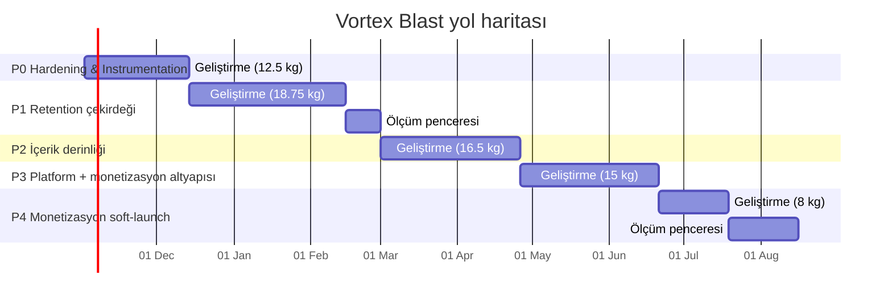
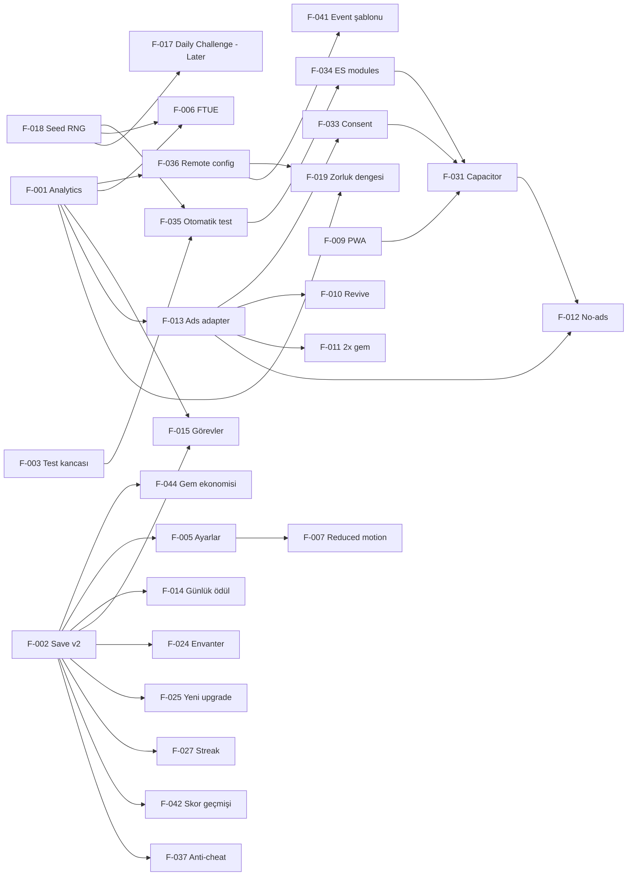

# 03 — Ürün Yol Haritası

> Başlangıç **2026-11-02 (Pazartesi)** · Ekip `[VARSAYIM]`: 1 geliştirici + Claude Code, 20 sa/hafta = **2,5 kişi-gün/hafta** · Tampon ×1,2.
> Takvim ve kapasite tablosu `tools/backlog.py` ile üretilir. Feature ID'leri `02_FEATURE_BACKLOG.md` ile aynıdır.

> **Durum (2026-10-26):** P0–P4 ve "Later" kapsamındaki özelliklerin kodu planlanandan erken tamamlandı. 44 özelliğin 41'i uygulandı, 3'ü kısmi; ayrıntılar `02_FEATURE_BACKLOG.md` Durum sütununda ve GDD §14'te.
>
> Takvim artık **ölçüm** için geçerli, geliştirme için değil:
> - G1 (web kohortu) ve G2 (Android soft-launch) kapıları gerçek oyuncu verisi ister.
> - Mağaza derlemesi (F-031) bu makinede yapılamıyor (Node.js, Android Studio yok). Önce **web yayını** (GitHub Pages, PWA) ile G1 web kohortu ölçülecek; Pages `main` kökünden yayınlıyor (merge = yayın), gizlilik iletişim bilgisi ve analitik uç noktası bekliyor (`STORE.md`).
> - Bot modeli, analitik verisiyle kalibre edilmeli (R1).

## 1. Strateji özeti

**Kuzey yıldızı metrik:** **D7 retention**. Hybrid-casual'da hem retention hem gelir bu metriğe bağlı `[ARAŞTIRMA S4]`. Hedef ≥ %10 (00_RESEARCH §5 çıpası).

**3 stratejik bahis:**
1. **Önce çekirdeği düzelt, sonra büyüt.** Model, as-built zorluk ve ekonominin bozuk olduğunu gösteriyor: sonsuz run, 25 dk'da biten meta (GDD §5–6). İçerik ve monetizasyon, düzeltilmiş çekirdeğin üstüne kurulacak.
2. **Web'de ölç, store'da para kazan** (ADR-1). Retention web/PWA'da ucuza ölçülüyor. Monetizasyon ise Capacitor + Android soft-launch ile.
3. **Hafif meta + günlük döngü** (ADR-4, ADR-5). Seviye haritası veya ikinci para birimi yok. Görev, günlük ödül ve yeni sink'ler var.

## 2. Fazlar

<!-- INCLUDE:out/capacity.md -->
| Faz | Ad | Effort (kişi-gün) | Saf hafta | Tamponlu hafta | Ölçüm (hafta) | Başlangıç | Bitiş |
|---|---|---:|---:|---:|---:|---|---|
| P0 | Hardening & Instrumentation | 12.5 | 5.0 | 6 | 0 | 2026-11-02 | 2026-12-13 |
| P1 | Retention çekirdeği | 18.75 | 7.5 | 9 | 2 | 2026-12-14 | 2027-02-28 |
| P2 | İçerik derinliği | 16.5 | 6.6 | 8 | 0 | 2027-03-01 | 2027-04-25 |
| P3 | Platform + monetizasyon altyapısı | 15 | 6.0 | 8 | 0 | 2027-04-26 | 2027-06-20 |
| P4 | Monetizasyon soft-launch | 8 | 3.2 | 4 | 4 | 2027-06-21 | 2027-08-15 |
| **P0–P4** | | **70.75** | | | | **2026-11-02** | **2027-08-15** (41 hafta) |
| Later (kesildi) | P5 LiveOps & genişleme adayı | 35.5 | 14.2 | 18 | | — | — |

Kapasite: 20 sa/hafta = 2.5 kişi-gün/hafta; tampon ×1.2.
<!-- /INCLUDE -->

### P0 — Hardening & Instrumentation (6 hafta)
- **Hedef:** Ölçülebilir, test edilebilir, dengelenmiş bir çekirdek.
- **Kapsam:** F-001, F-002, F-003, F-018, F-019, F-035, F-036, F-044
- **Çıkış kriterleri (ölçülebilir):**
  1. `python docs/tools/vb_proposed.py` çıktısında:
     - Skilled bot 900 sn tavanına %0 oranında ulaşıyor.
     - Casual medyan run 90–180 sn.
     - Maks. upgrade novice medyanı, upgrade'siz medyandan kısa değil.
  2. Headless smoke testi (F-035): hata 0, otomatik blast sonrası skor > 0.
  3. GDD §10.1'deki 14 event'in tamamı test ortamında tetikleniyor.
  4. v1 save, v2'ye kayıpsız taşınıyor (6 test senaryosu).
- **KPI hedefi:** Henüz canlı kohort yok. Hedef, ölçüm altyapısının hazır olması.
- **Riskler:** Bot modeli ile gerçek oyuncu farkı (R1).
- **Bu fazda yapılmayacaklar:** Yeni UI ekranları, içerik, reklam.

### P1 — Retention çekirdeği (9 hafta + 2 hafta ölçüm)
- **Hedef:** İlk 7 günü taşıyan sistemler.
- **Kapsam:** F-004, F-005, F-006, F-007, F-009, F-014, F-015, F-032, F-043
- **Çıkış kriterleri:**
  1. PWA kurulabilir (Lighthouse installable) ve çevrimdışı açılıyor.
  2. FTUE hunisi ölçülüyor.
  3. TR/EN metinler taşmadan görünüyor.
  4. **G1 kapısı** geçildi (§5).
- **KPI hedefi (web kohortu)** `[VARSAYIM]`: D1 ≥ %25, D7 ≥ %8, FTUE tamamlama ≥ %80, medyan run 90–180 sn. Web kohortu store'dan düşük beklendiği için store çıpalarının (D1 %30 / D7 %10) yaklaşık %80'i alındı.
- **Riskler:** Organik web trafiği yetersiz kalabilir (R3).
- **Bu fazda yapılmayacaklar:** Müzik (Later), Daily Challenge (Later), reklam.

### P2 — İçerik derinliği (8 hafta)
- **Hedef:** D7'den D30'a uzanan çeşitlilik ve gem sink'leri.
- **Kapsam:** F-021, F-022, F-024, F-025, F-027, F-030, F-034, F-038, F-042
- **Çıkış kriterleri:**
  1. Model: F-025 sonrası casual için "tüm upgrade'leri bitirme" ≥ 100 run.
  2. Joker ve renk bombası ile ortalama run süresi değişimi ≤ ±%15 (model).
  3. ES module'e geçiş sonrası headless parity testi geçiyor.
  4. Web kohortunda D7, P1'e göre ≥ +1 puan.
- **Riskler:** Okunabilirlik (R5). Modülerleşme regresyonu (R6).
- **Bu fazda yapılmayacaklar:** Kilitli blok, boss dalga, booster'lar (Later). Kozmetik (Later).

### P3 — Platform + monetizasyon altyapısı (8 hafta)
- **Hedef:** Android'de mağazaya hazır, consent'e uyumlu, reklam soyutlaması hazır bir build.
- **Kapsam:** F-013, F-031, F-033, F-037
- **Çıkış kriterleri:**
  1. Play iç test kanalında yayında.
  2. CMP ve yaş kapısı çalışıyor. Consent yokken kişiselleştirilmiş reklam ve analitik ID gönderilmiyor.
  3. Mock reklamla revive ve 2× gem uçtan uca çalışıyor.
  4. Orta segment Android'de 60 fps (perfWatch kalitesi 2'de kalıyor).
- **Riskler:** Mağaza politikası / Families (R4). Capacitor build karmaşıklığı (R6).
- **Bu fazda yapılmayacaklar:** iOS (G2 sonrası), IAP (P4).

### P4 — Monetizasyon soft-launch (4 hafta + 4 hafta ölçüm)
- **Hedef:** Sınırlı GEO'da Android soft-launch. Gelir ve retention'ı birlikte ölçmek.
- **Kapsam:** F-010, F-011, F-012, F-041
- **Çıkış kriterleri:** **G2 kapısı** (§5).
- **KPI hedefi:** D1 ≥ %30, D7 ≥ %10, D30 ≥ %3 `[ARAŞTIRMA S1–S3]`. Revive opt-in ≥ %30 `[ARAŞTIRMA S7]`.
- **Riskler:** Düşük eCPM (R7). Revive dengeyi bozabilir (R2).
- **Bu fazda yapılmayacaklar:** Interstitial. Ancak E4 deneyi kapsamında, G2 verisine göre açılır.

### P5 / Later — LiveOps & genişleme (plan dışı, 35,5 kişi-gün)
- **Aday kapsam:** F-008, F-016, F-017, F-020, F-023, F-026, F-028, F-029, F-039, F-040
- **Neden kesildi:** 20 sa/hafta kapasiteyle P0–P4 zaten 41 hafta sürüyor. Bu kalemler 18 hafta daha eklerdi. Önceliklendirme G2 verisiyle yapılacak.

## 3. Now / Next / Later

| Now (P0, Kas–Ara 2026) | Next (P1–P2, Ara 2026–Nis 2027) | Later (P3–P4 ve sonrası) |
|---|---|---|
| F-003 Test kancası | F-004 Pause | F-013 Ads adapter |
| F-018 Seed'li RNG | F-005 Ayarlar | F-031 Capacitor |
| F-002 Save v2 | F-006 FTUE | F-033 Consent |
| F-001 Analytics | F-007 Reduced motion | F-037 Anti-cheat |
| F-036 Remote config | F-009 PWA | F-010 Revive |
| F-019 Zorluk dengesi | F-014 Günlük ödül | F-011 2× gem |
| F-044 Gem ekonomisi | F-015 Görevler | F-012 No-ads |
| F-035 Otomatik test | F-032 TR/EN | F-041 Event şablonu |
| | F-043 Sonraki hedef | P5: F-008, F-016, F-017, F-020, F-023, F-026, F-028, F-029, F-039, F-040 |
| | F-021 Joker, F-022 Renk bombası | |
| | F-024 Envanter, F-025 Yeni upgrade'ler | |
| | F-027 Streak, F-030 Paylaşım, F-038 Son şans, F-042 Skor geçmişi | |
| | F-034 ES modules | |

## 4. Takvim ve bağımlılıklar

<!-- INCLUDE:out/gantt.md -->

<!-- /INCLUDE -->

Ölçüm pencerelerinde yeni özellik geliştirilmez. Yalnızca hata düzeltme ve bir sonraki fazın tasarım hazırlığı yapılır. Kapasite tablosuna bu pencereler dahildir.

## 5. Go / No-Go kapıları

| Kapı | Zaman | Go kriterleri (hepsi) | No-Go olursa |
|---|---|---|---|
| **G0** | P0 sonu (2026-12-13) | P0 çıkış kriterleri 1–4 | P1'e geçme. Tuning'i 1 sprint daha iterasyonla düzelt |
| **G1** | P1 ölçüm sonu (2027-02-28) | Web kohortu ≥ 1.000 kurulum `[VARSAYIM]`. D1 ≥ %25, D7 ≥ %8, FTUE ≥ %80, medyan run 90–180 sn | D1 düşükse FTUE/tuning için 2 hafta iterasyon. D7 düşükse P2'den F-025 ve F-027 öne alınır. İki iterasyon sonra hâlâ D1 < %20 ise **çekirdek mekanik yeniden değerlendirilir** (dönen tahta + süre baskısı) |
| **G2** (soft-launch) | P4 ölçüm sonu (2027-08-15) | Android, sınırlı GEO. D1 ≥ %30, D7 ≥ %10, D30 ≥ %3 `[ARAŞTIRMA S1–S3]`. Revive opt-in ≥ %30 `[ARAŞTIRMA S7]`. Crash-free ≥ %99,5 `[VARSAYIM]`. Ölçülmüş ARPDAU > 0 ve LTV/CPI hesabı yapılmış | Global/iOS çıkışı yok. Retention zayıfsa P5'ten retention kalemleri, monetizasyon zayıfsa E4 (interstitial) ve IAP deneyleri |

## 6. Kapasite kontrolü
- Backlog toplamı **106,25 kişi-gün**. 2,5 kişi-gün/hafta ile yaklaşık 42,5 hafta, tamponla yaklaşık 51 hafta. Ölçüm pencereleri (6 hafta) eklenince 2026-11-02'den itibaren yaklaşık **57 hafta** sürer.
- Bu nedenle **35,5 kişi-gün kesildi** (Later, §2 P5). Plan: P0–P4 = **70,75 kişi-gün → 41 hafta (2026-11-02 → 2027-08-15)**, ölçüm pencereleri dahil.
- Kesilenler ve gerekçe:
  - Müzik (F-008, 4 kg): juice var, retention'a doğrudan etkisi düşük güvenli.
  - Daily Challenge (F-017, 4 kg): ölçülecek kitle oluşmadan anlamsız.
  - Kilitli blok ve boss (F-020 + F-028, 8 kg): okunabilirlik riski, önce joker ve renk bombası ölçülecek.
  - Booster'lar (F-023, 4 kg): envanter (F-024) önce.
  - Kozmetik ve sezon (F-026 + F-040, 11 kg): IAP verisi gerekiyor.
  - Başarımlar (F-016), Zen (F-029), renk körü desenleri (F-039).

## 7. Risk register

| # | Risk | Olasılık (1–5) | Etki (1–5) | Skor | Azaltma | Sahip |
|---|---|---:|---:|---:|---|---|
| R1 | Bot modeli gerçek oyuncuyu temsil etmiyor, tuning yanlış | 4 | 4 | 16 | F-001 ile tap aralığı ve küme boyu ölçülüp `BOTS` kalibre edilir. Remote config ile canlı düzeltme (F-036) | Geliştirici |
| R2 | Tuning ve revive birlikte dengeyi tekrar bozar | 3 | 4 | 12 | Her denge değişikliği `vb_proposed.py` regresyonundan geçer. Revive run başına 1 | Geliştirici |
| R3 | Organik web trafiği G1 için yetersiz | 4 | 3 | 12 | Web oyun portalları ve topluluklar `[VARSAYIM]`. G1 eşiği 1.000 kurulumla sınırlı. Küçük reklam testi | Geliştirici |
| R4 | Store politikası (Families/çocuk algısı, 4.2) reddi | 3 | 4 | 12 | Hedef kitle beyanı hukuki görüşle. Yaş kapısı, self-certified SDK `[ARAŞTIRMA S24]`. iOS'ta native özellikler (haptik, IAP) | Geliştirici + hukuk |
| R5 | Yeni bloklar okunabilirliği bozar | 3 | 3 | 9 | 400 px ekranda test. Spawn oranları remote config'te | Geliştirici |
| R6 | Modülerleşme/Capacitor regresyonu | 3 | 3 | 9 | Parity ve smoke testleri (F-035), ADR-2 eşiği | Geliştirici |
| R7 | Düşük eCPM (TR/gelişen GEO) gelir hedefini tutturmaz | 4 | 3 | 12 | Soft-launch GEO karışımı. IAP (no-ads, starter). LTV/CPI ölçülmeden UA yapılmaz | Geliştirici |
| R8 | KVKK/GDPR uyumsuzluğu (yurt dışı aktarım) | 2 | 5 | 10 | Analitik consent öncesi anonim. SCC'li sağlayıcı seçimi `[ARAŞTIRMA S26]` | Geliştirici + hukuk |
| R9 | Kapasite (20 sa/hafta) kayması | 3 | 3 | 9 | %20 tampon. Her faz sonunda Later'a itme kararı | Geliştirici |
| R10 | Combo penceresi kısalınca "juice" hissi azalır | 2 | 3 | 6 | E2 deneyi (1,8 / 1,3 / 1,1 sn) | Geliştirici |

## 8. Sprint 1–2 ayrıntılı plan (2 haftalık sprint, sprint başına yaklaşık 5 kişi-gün, tamponla yaklaşık 4,2 net)

> Tümü mevcut `index.html` içinde yapılır. Modülerleşme P2'de (F-034). Her görev Claude Code'a tek istek olarak verilebilecek büyüklüktedir.

### Sprint 1 — 2026-11-02 → 2026-11-15 (hedef 4,5 kişi-gün)
| # | Görev | Feature | Dosya / fonksiyon | Tahmin | Bitti tanımı | Durum |
|---|---|---|---|---:|---|---|
| 1.1 | `window.__vortex` bloğunu `const DEBUG = /[?&]debug=1/.test(location.search) \|\| location.hostname === 'localhost'` koşuluna al. `setStability` yalnızca DEBUG'da | F-003 | `index.html` dosya sonu `window.__vortex` | 0,25 | Üretim URL'sinde `window.__vortex === undefined` | Bitti 2026-10-26 (smoke: production) |
| 1.2 | `mulberry32(seed)` ekle. `rng()` ile `Math.random` ayrımı: oynanış = `newBlock` rengi, `fillBoardFresh`, `spawnColor`, `rand` çağrılarının oynanışı etkileyenleri. Kozmetik (`burst`, `buildBg`, dust) `Math.random`'da kalır. `startGame` seed atar | F-018 | utils, `fillBoardFresh`, `spawnColor`, `startGame` | 0,75 | Aynı seed → aynı ilk 60 spawn rengi (konsol testi) | Bitti 2026-10-26 (smoke: fresh) |
| 1.3 | Save v2: `save.v = 2`, `migrate1to2`, `settings/stats/daily/inventory/history` varsayılanları, bozuk JSON → `vortexBlast.save.bak`. `SAVE_KEY` değişmez, sürüm içeride | F-002 | `load`, `persist`, `save` | 1,5 | 6 senaryo (boş, v1 tam, v1 eksik alan, bozuk JSON, v2, gelecekteki v3 alanı korunur) elle doğrulandı | Bitti 2026-10-26 (smoke: 4 senaryo) |
| 1.4 | `GEM_RATE = 0.15` ve `gemFrac` birikimi. `addGems` içinde uygulanır. Run sonu kartı tam sayı gösterir. `waveUp` gem'i de `addGems` üzerinden geçer (zaten öyle). `vb_model.PROPOSED.gem_rate` ile eşitlik kontrolü ve `progression_compare.md` sonucunun gözden geçirilmesi | F-044 | `addGems`, `drawOver` | 1,0 | Model ile aynı formül. 1 casual run'da yaklaşık 40–50 gem (manuel) | Bitti 2026-10-26 (kod); oyun içi doğrulama bekliyor |
| 1.5 | Headless smoke scripti: `docs/tools/smoke.py`. Chrome headless + `?debug=1`. Bu oturumda kullanılan probe kalıcı hâle getirilir | F-035 (1/2) | `docs/tools/` (yeni) | 1,0 | Tek komut. Hata 0, blast sonrası skor > 0 | Bitti 2026-10-26 (28/28 PASS) |

### Sprint 2 — 2026-11-16 → 2026-11-29 (hedef 4,2 kişi-gün)
| # | Görev | Feature | Dosya / fonksiyon | Tahmin | Bitti tanımı | Durum |
|---|---|---|---|---:|---|---|
| 2.1 | `Track` modülü: kuyruk, `localStorage` tamponu (≤ 200), `navigator.sendBeacon` ile 30 sn'de bir/`pagehide`. Endpoint boşsa yalnızca yerel. Consent bayrağı `save.consent.analytics` | F-001 | yeni `Track` (Snd'nin altına) | 1,5 | Event'ler `localStorage['vb.q']`'da görünüyor. Frame süresine etkisi < 0,2 ms | Bitti 2026-10-26 |
| 2.2 | 14 event'in tetik noktalarına eklenmesi (GDD §10.1) | F-001 | `startGame`, `doBlast`, `doBomb`, `waveUp`, `gameOver`, `buy`, `toggleDrawer`, `perfWatch`, `visibilitychange` | 1,5 | Debug overlay'de event sayaçları | Bitti 2026-10-26 |
| 2.3 | Parity testi: aynı seed ile JS'te 50 `settle` sonrası grid renkleri ↔ `vb_model.py` | F-035 (2/2) | `docs/tools/parity.py`, `window.__vortex` (debug) | 1,0 | Fark 0 | Bitti 2026-10-26 |
| 2.4 | Sprint 3 hazırlığı: `drainRate`, `doBomb`, `COMBO_WINDOW`, `waveScore` kontrolünü `CFG` nesnesine taşı (remote config'in ön adımı, davranış değişmez) | F-036 hazırlık | config bölümü | 0,25 | As-built davranış birebir (smoke testi) | Bitti 2026-10-26 |

**Sprint 3 (2026-11-30 → 12-13):** F-036 (remote config + A/B, 2 kg) ve F-019 (PROPOSED tuning'in `CFG`'ye uygulanması + model regresyonu, 2 kg). Sonunda G0 kapısı.
